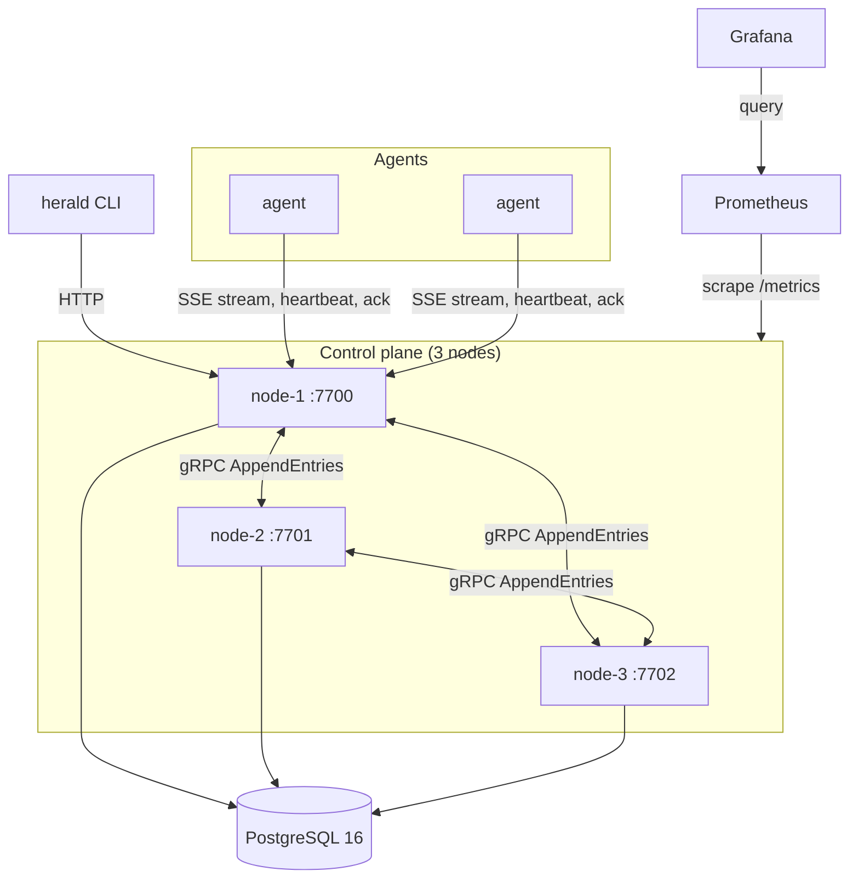
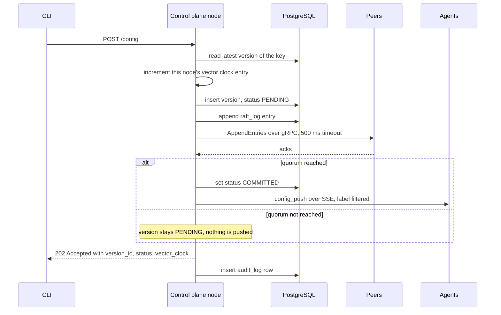

# Architecture

Herald pushes typed configuration changes from a small control-plane cluster to running services (agents) over long-lived streams, and records every change in an append-only audit trail. This document describes the components, the data model, and what happens on a write.

- [Components](#components)
- [Write path](#write-path)
- [Push path](#push-path)
- [Agent lifecycle](#agent-lifecycle)
- [Data model](#data-model)
- [Failure behavior](#failure-behavior)
- [Where Herald differs from a textbook design](#where-herald-differs-from-a-textbook-design)

## Components



| Component                  | Binary                           | Responsibility                                                                                                                                         |
| -------------------------- | -------------------------------- | ------------------------------------------------------------------------------------------------------------------------------------------------------ |
| **Control plane**          | `cmd/control-plane`              | HTTP API, leader election, quorum replication, SSE fan-out, agent registry, audit log, `/metrics`                                                      |
| **Agent**                  | `cmd/agent`                      | Registers with a control-plane node, holds an SSE stream open, applies pushed config to a local in-memory cache, acks each version, serves local reads |
| **CLI**                    | `cmd/cli`, installed as `herald` | Writes config, reads, diffs, watches, rolls back, shows agent status and the audit log                                                                 |
| **PostgreSQL**             | n/a                              | Durable state for versions, the replication log, acks, the agent registry and the audit log; also the arbiter for leader election                      |
| **Prometheus and Grafana** | n/a                              | Optional. Scrape each node, render the provisioned _Herald Overview_ dashboard                                                                         |

Internal packages:

| Package                | Role                                                                |
| ---------------------- | ------------------------------------------------------------------- |
| `internal/api`         | HTTP handlers, SSE hub, agent registry endpoints, metrics wiring    |
| `internal/raft`        | Leader election, log append, `AppendEntries` client and gRPC server |
| `internal/store`       | Postgres access and embedded migrations runner                      |
| `internal/vectorclock` | Per-key vector clocks                                               |
| `internal/fsm`         | Rollback state machine                                              |
| `internal/targeting`   | Label selector parsing and the in-memory agent label index          |
| `internal/audit`       | Audit log writer                                                    |
| `internal/metrics`     | Prometheus registry and instruments                                 |

## Write path

A write is `POST /config` on any control-plane node. The node that receives it coordinates the write.



Step by step:

1. **Validate.** `key` and `value` are required. `namespace` defaults to `default` and `pushed_by` to `anonymous`.
2. **Version.** The node loads the latest version of the key, copies its vector clock and increments its own entry. The new row is inserted into `config_versions` with status `PENDING`, linked to its predecessor through `previous_id`.
3. **Log.** The version is appended to `raft_log` at the next index.
4. **Replicate.** The node sends one `AppendEntries` RPC to every configured peer in parallel, each with a 500 ms deadline. The write reaches quorum when `acks + 1 >= floor((peers + 1) / 2) + 1`, counting the node itself. With three nodes that is 2 of 3. A node with no peers configured treats every write as committed.
5. **Commit.** On quorum the version becomes `COMMITTED` and is pushed to agents. Without quorum the version stays `PENDING` and nothing is pushed. The HTTP response is `202 Accepted` in both cases, and its `status` field says which one happened.
6. **Audit.** After the response is written, a `CONFIG_WRITE` row is inserted into `audit_log` with the old value, the new value, the vector clock and the actor.

`herald_propagation_latency_ms` measures steps 1 to 5 up to the point the push has been handed to the SSE hub.

## Push path

Each control-plane node keeps an in-memory **hub** of connected agents.

- An agent opens `GET /agents/stream` and sends its ID, namespace and labels. The hub gives it a buffered channel (16 messages) and indexes its labels.
- On commit, the node calls `broadcastTargeted(namespace, payload, selector)`. Every agent in the namespace receives the push, unless the write carried targeting labels, in which case only agents whose labels match all of them do. Matching is exact `key=value`, combined with AND. An empty selector matches everyone in the namespace.
- If an agent's channel is full, the message is dropped for that agent, a warning is logged and `herald_delivery_failures_total` is incremented.
- Clients watching a key (`herald config watch`) receive the same payload through a separate watcher list.

The payload is a single JSON event:

```json
{
  "type": "config_push",
  "version_id": "5c1f...",
  "namespace": "prod",
  "delta": { "feature.checkout": { "enabled": true } }
}
```

The agent ignores a `version_id` it has already applied, writes the delta into its cache, and calls `POST /ack`. The ack is stored in `ack_states` keyed by `(version_id, agent_id)`, so repeated acks are harmless.

## Agent lifecycle

| Event                  | What happens                                                                                                          |
| ---------------------- | --------------------------------------------------------------------------------------------------------------------- |
| Start                  | `POST /agents/register` with ID, namespace and labels (retried every 2 s until it succeeds), then open the SSE stream |
| Every 500 ms           | `POST /heartbeat` with the last applied `version_id`; the node updates `last_seen` and marks the agent `HEALTHY`      |
| No heartbeat for 1.5 s | The stale detector marks the agent `STALE`                                                                            |
| No heartbeat for 5 s   | The stale detector marks the agent `DEAD`                                                                             |
| Stream drops           | The agent reconnects every 2 s                                                                                        |
| Local read             | Applications read the agent's cache on `:8800/config/{key}`, so reads never leave the host                            |

The stale detector runs every 500 ms on each control-plane node. `herald status` shows every agent's state, labels and last heartbeat.

## Data model

All durable state lives in PostgreSQL. The control plane applies the SQL files in `migrations/` on startup under an advisory lock, so several nodes can start at once.

| Table                                | Purpose                                                                                                                                                                                                   |
| ------------------------------------ | --------------------------------------------------------------------------------------------------------------------------------------------------------------------------------------------------------- |
| `config_versions`                    | One row per write or rollback. Holds key, namespace, JSON value, vector clock, status, targeting labels, `previous_id` and `pushed_by`. Rows are never edited except for the status moving to `COMMITTED` |
| `raft_log`                           | Ordered replication log. `log_index` is unique and entries are written once. A sentinel entry at index 0 seeds the log                                                                                    |
| `ack_states`                         | Which agent acknowledged which version                                                                                                                                                                    |
| `agent_registry`                     | Agent ID, namespace, labels, status, `last_seen`, last applied version                                                                                                                                    |
| `audit_log`                          | Every write and rollback with old and new values. A database trigger rejects `UPDATE` and `DELETE`, so the log is append-only even for a client with direct SQL access                                    |
| `delivery_failures`                  | Reserved for failed deliveries; not written to yet                                                                                                                                                        |
| `schema_registry`, `targeting_rules` | Reserved for typed schemas and saved selectors                                                                                                                                                            |

`config_versions.status` is one of `PENDING`, `PROPAGATING`, `COMMITTED`, `ROLLING_BACK` or `ROLLED_BACK`. The write path currently uses `PENDING` and `COMMITTED`.

## Failure behavior

| Situation                   | Behavior                                                                                                                                                                   |
| --------------------------- | -------------------------------------------------------------------------------------------------------------------------------------------------------------------------- |
| Leader process dies         | PostgreSQL releases its advisory lock when the session ends. Every node polls for the lock every 200 ms, so another node takes over on its next tick and starts a new term |
| A peer is unreachable       | Its `AppendEntries` times out after 500 ms and counts as no ack. Writes still commit while a quorum remains                                                                |
| Quorum lost                 | Writes return `202` with status `PENDING`, nothing is pushed, and the version stays `PENDING`                                                                              |
| Agent restarts              | It registers again, reconnects and receives the next push. It does not replay history on reconnect                                                                         |
| Agent is slow               | Its 16-message buffer fills, further pushes to it are dropped and counted                                                                                                  |
| Control-plane node restarts | State is reloaded from PostgreSQL. Agent connections to that node drop and the agents reconnect                                                                            |

## Where Herald differs from a textbook design

Herald is Raft-inspired, not a full Raft implementation. These points matter if you are evaluating it:

- **Shared PostgreSQL.** Every node talks to the same database, and leadership is decided by a Postgres advisory lock (key 42) instead of randomized election timeouts and `RequestVote` rounds. The `AppendEntries` step writes to the same `raft_log` table the leader already wrote to, so in this topology it works as a quorum liveness gate rather than as data replication. PostgreSQL itself is the single source of truth and its availability is Herald's availability.
- **Fan-out is local to the receiving node.** The SSE hub is in memory per node, and a follower does not push to its agents when it receives an `AppendEntries`. A write reaches the agents connected to the node that handled the write. Point agents at the node you write to, or put them behind a single address, until cross-node fan-out lands.
- **Followers learn the term lazily.** Term and leader ID reach followers only through `AppendEntries`, so a follower reports term `0` and no leader until the first replicated write.
- **Any node accepts writes.** There is no leader check on `POST /config` yet.
- **Vector clocks are recorded, not yet used for conflict handling.** Each version carries a per-key vector clock, and `Merge` and `Concurrent` exist in `internal/vectorclock`, but the write path only increments.

The full list of known gaps is in [limitations](limitations.md).
